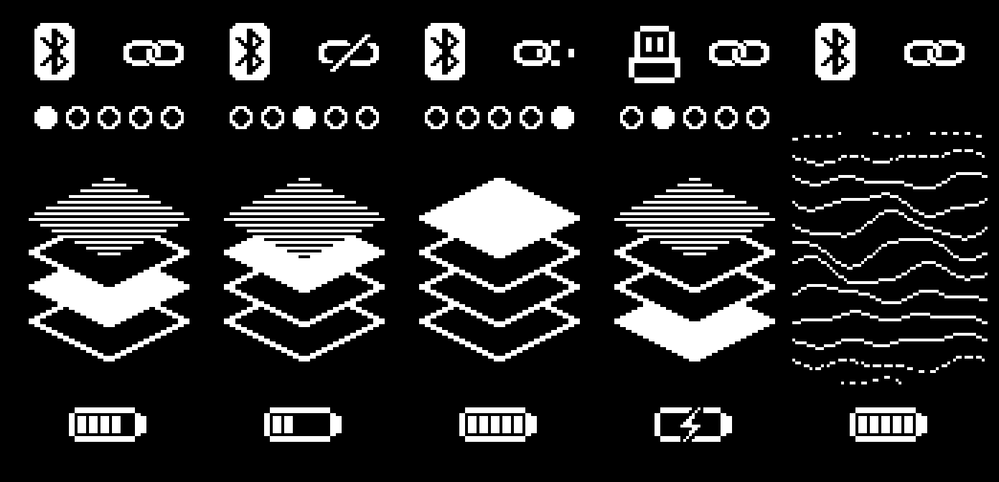
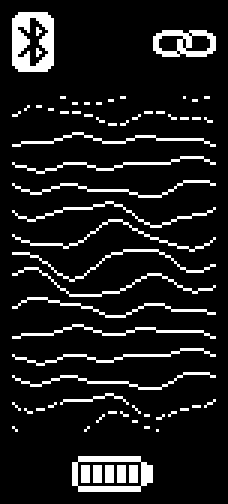

# nice-view-strata

A vertical status screen for the [nice!view](https://nicekeyboards.com/nice-view/) on split [ZMK](https://zmk.dev) keyboards such as the Corne. Every icon is hand-set 1-bit pixel art, drawn to the display pixel for pixel with nothing scaled or smoothed.



**Left half (central)**

- USB or Bluetooth badge, with a link icon beside it: linked, pairing (second link dashed) or disconnected (link cut).
- Five circles for the Bluetooth profiles, the active one filled.
- A stack of tiles, one per keymap layer, with the active layer filled.
- Battery in five cells, with a bolt while charging.

**Right half (peripheral)**

- Link to the left half and its own battery.
- Swell lines that move for one loop when the half starts or connects, then stay still, so the display is not redrawn while you type.



A peripheral half cannot know the layer, profile or output in ZMK, which is why the right screen shows only its own state.

## Requirements

- ZMK **v0.3** (Zephyr 3.5, LVGL 8) or ZMK `main` (LVGL 9), tested against `main` as of 2026-11-14 ([`4de3133`](https://github.com/zmkfirmware/zmk/commit/4de3133)).
- A nice!view mounted upright (portrait, 68 x 160), using the stock `nice_view` shield.

## Install

1. In `config/west.yml`, add the remote and the project:

   ```yaml
   manifest:
     remotes:
       - name: zmkfirmware
         url-base: https://github.com/zmkfirmware
       - name: am
         url-base: https://github.com/am
     projects:
       - name: zmk
         remote: zmkfirmware
         revision: v0.3
         import: app/west.yml
       - name: nice-view-strata
         remote: am
         revision: main
     self:
       path: config
   ```

2. Keep the stock `nice_view` shield in `build.yaml`:

   ```yaml
   include:
     - board: nice_nano_v2
       shield: corne_left nice_view_adapter nice_view
     - board: nice_nano_v2
       shield: corne_right nice_view_adapter nice_view
   ```

3. In your keyboard's `.conf` file (for example `config/corne.conf`):

   ```ini
   CONFIG_ZMK_DISPLAY=y
   CONFIG_ZMK_DISPLAY_STATUS_SCREEN_CUSTOM=y
   CONFIG_NICE_VIEW_WIDGET_STATUS=n
   CONFIG_NICE_VIEW_STRATA=y
   ```

4. Build and flash both halves.

## Options

| Option | Default | What it does |
| --- | --- | --- |
| `CONFIG_NICE_VIEW_WIDGET_INVERTED` | `n` | Stock nice!view option. `n` gives light pixels on black, `y` gives black on light. Power use is the same either way. |
| `CONFIG_NICE_VIEW_STRATA_BASE_LAYER_SECOND` | `y` | The base layer is the second tile from the bottom and the next keymap layer (usually "lower") is the bottom tile, so the stack reads lower, base, raise. Set `n` for plain keymap order with the base layer at the bottom. |
| `CONFIG_NICE_VIEW_STRATA_ANIMATION` | `y` | Play the swell animation on the peripheral half when it starts or connects. |
| `CONFIG_NICE_VIEW_STRATA_ANIMATION_FRAME_MS` | `80` | Time between animation frames, 30 to 1000 ms. |

The layer stack has one tile per keymap layer and is designed around four. With more layers the tiles move closer together to fit.

## Changing the icons

The icons live as text in [`src/strata/assets/icons.txt`](src/strata/assets/icons.txt), one character per pixel. Edit them, then regenerate the C data:

```sh
python3 scripts/gen_assets.py
```

The drawing code in `src/strata/draw.c` is plain C with integer math only, so it also compiles on a computer for previews.

## Licence

MIT, see [LICENSE](LICENSE). The USB icon is from [Pixelarticons](https://github.com/halfmage/pixelarticons) (MIT).
